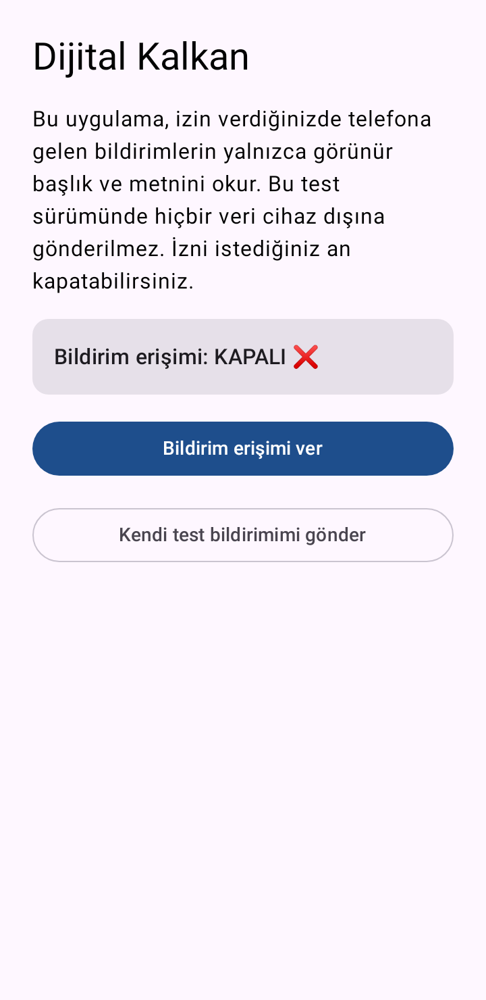

# DİJİTAL KALKAN

**Türkçe Yapay Zekâ Destekli Çoklu Ortam Çocuk Dijital Güvenlik Sistemi**
TÜBİTAK 2204-A Lise Öğrencileri Araştırma Projesi

Çocuğun Android telefonunda, **görünür ve açık rızayla** çalışan; bildirim, ekran (OCR) ve ses
kaynaklarındaki zararlı Türkçe içeriği **cihaz üzerinde** sınıflandırıp ebeveyne yalnızca
risk özetini ileten bir prototip.



## Mevcut durum: Aşama 1 – Bildirim dinleyici

| Bileşen | Dosya |
|---|---|
| Bildirim dinleyici servis | `app/src/main/java/com/digitalkalkan/app/monitoring/notification/MessageNotificationListener.kt` |
| İzin kontrolü | `app/src/main/java/com/digitalkalkan/app/permissions/NotificationAccess.kt` |
| Test bildirimi | `app/src/main/java/com/digitalkalkan/app/notifications/TestNotificationHelper.kt` |
| Ana ekran | `app/src/main/java/com/digitalkalkan/app/MainActivity.kt` |
| Ekran görüntüsü testi | `app/src/test/java/com/digitalkalkan/app/MainScreenScreenshotTest.kt` |
| Test kaydı | `docs/test_asama1.md` |

## APK nasıl alınır?
1. GitHub'da **Actions** sekmesi → en son başarılı "Android APK" çalışması → **Artifacts** →
   `DijitalKalkan-debug-apk` indirin (zip içinden `app-debug.apk` çıkar).
2. APK'yı telefona atıp kurun ("Bilinmeyen kaynaklardan yükleme" izni istenir).
3. Bildirim erişimi anahtarı gri ise: **Ayarlar → Uygulamalar → Dijital Kalkan → ⋮ →
   "Kısıtlanmış ayarlara izin ver"**.

## Android Studio ile çalıştırma
- Android Studio (güncel Stable) → **File → Open** → bu klasör.
- Telefon USB hata ayıklama açık bağlı → **Run ▶**.
- Logcat filtresi: `tag:DK-Notif`

## Teknik bilgiler
- Kotlin, Jetpack Compose, minSdk 29 (Android 10), targetSdk 36
- Android Gradle Plugin 9.5, Gradle 9.8 (wrapper), JDK 17+
- Ekran görüntüleri: `./gradlew testDebugUnitTest` → `app/build/screenshots/`

## Gizlilik ilkeleri
- Ham mesaj, ses ve görüntü cihazdan çıkmaz; ebeveyne yalnızca kategori/uygulama/zaman/kısa uyarı.
- Gerçek çocuk verisi toplanmaz; araştırmada sentetik, kontrollü veya uygun izinli anonim veri kullanılır.
- `LOG_CONTENT = true` yalnızca geliştirme testindir; sonraki aşamada kapatılacaktır.
- Ham veri dosyaları (`python/dataset/raw/`) depoya **eklenmez**.

## Klasör yapısı
```
app/src/main/java/com/digitalkalkan/app/
  ui/  domain/{model,analysis}/  data/{local,repository}/
  monitoring/{notification,screen,audio}/  ml/{ocr,speech,classification}/
  permissions/  notifications/
app/src/main/assets/models/
python/{dataset,training,evaluation,export}/
docs/
```
