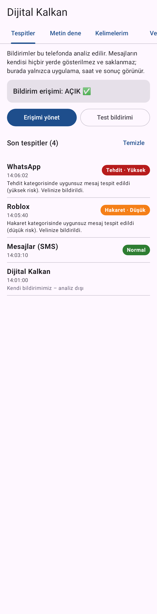
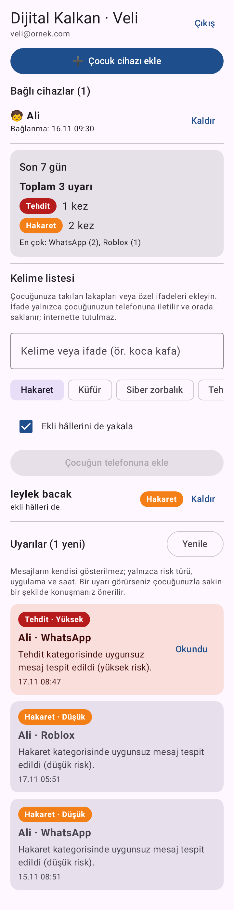

# DİJİTAL KALKAN

**Türkçe Yapay Zekâ Destekli Çocuk Dijital Güvenlik Sistemi**
TÜBİTAK 2204-A Lise Öğrencileri Araştırma Projesi · Prototip sürüm **1.0.0**

 

## Ne yapar?
Tek uygulama, iki rol:

| Çocuk telefonu | Veli telefonu |
|---|---|
| Gelen bildirimler **telefonun içinde** Türkçe analiz edilir (7 sınıf) | E-posta ile hesap, **6 haneli kodla** çocuk cihazı bağlama |
| **Mesajlar hiçbir yerde gösterilmez/saklanmaz**; yalnızca uygulama, saat, kategori | Bildirim: **"Tehdit kategorisinde uygunsuz mesaj tespit edildi"** |
| "Metin dene": cümle yazıp analiz sonucunu görme | Uyarı listesi, okundu işaretleme, **son 7 gün özeti** |
| "Kelimelerim": kendi lakap/ifade listesi + velinin eklediği ifadeler | **Kelime listesi**: lakap/özel ifadeyi çocuğun telefonuna ekleme/kaldırma |
| "Veli": açık onay, bağlanma, velisine giden uyarıları görme, bağlantıyı kaldırma | Bağlı cihazları görme / kaldırma |

Sınıflar: Normal, Küfür, Hakaret, Siber zorbalık, Tehdit, Uygunsuz yaklaşım (grooming), Kendine zarar.

## Gizlilik tasarımı
- **Mesaj metni, gönderen kişi ve kelime listeleri hiçbir sunucuda tutulmaz.**
- Ana kelime veritabanı (`app/src/main/assets/lexicon/tr_risk_lexicon.txt`) uygulamanın içindedir.
- Veliye giden tek bilgi: kategori, risk seviyesi, uygulama adı, saat.
- Velinin eklediği ifadeler sunucuda **saklanmadan** çocuğun telefonuna iletilir ve orada tutulur.
- Çocuk, bağlantıyı ve velisine giden uyarıları her zaman görür; bağlantıyı kaldırabilir.
- Sunucu (Supabase) yalnızca **eşleştirme ve uyarı iletimi** için kullanılır; ayrıntı: `supabase/README.md`.

## Kurulum ve test
- Telefonda deneme: **`docs/telefon_test_rehberi.md`**
- Aşama 1 test kaydı: `docs/test_asama1.md`
- Etiketleme kuralları: `docs/etiketleme_kilavuzu.md`
- OffensEval-TR: `docs/offenseval_rehberi.md`

## Proje yapısı
```
app/src/main/java/com/digitalkalkan/app/
  monitoring/notification/   bildirim dinleyici (NotificationListenerService)
  domain/analysis/           Türkçe normalleştirme + anahtar kelime analizi (Yöntem 1)
  domain/alerts/             veliye uyarı gönderimi
  data/remote/               Supabase bağlantısı
  data/repository/           kullanıcı / veli kelime listeleri (cihazda)
  notifications/             Firebase bildirim servisi
  ui/                        çocuk ekranları, veli ekranları, rol seçimi
app/src/main/assets/lexicon/ Türkçe risk sözlüğü
python/                      veri seti (2115 örnek, 7 sınıf), değerlendirme betikleri
supabase/                    veritabanı şeması, bildirim fonksiyonu, testler
docs/                        rehberler, test kayıtları, ekran görüntüleri
```

## Teknik bilgiler
Kotlin · Jetpack Compose · minSdk 29 (Android 10) · targetSdk 36 · AGP 9.5 · Gradle 9.8 ·
Supabase (Auth, Postgres + RLS, Edge Function) · Firebase Cloud Messaging

Testler: `./gradlew testDebugUnitTest` (analiz motoru Python ile 2143 cümlede birebir aynı;
ekran görüntüleri `app/build/screenshots/`).

## Henüz yapılmayanlar (plan)
- 5–6. hafta: Ekran yakalama (MediaProjection) + ML Kit OCR
- 7–8. hafta: Ses yakalama + konuşma tanıma (Vosk Türkçe)
- Yöntem 2 (klasik ML) ve Yöntem 3 (BERTurk/DistilBERTurk) model eğitimi ve LiteRT ile cihaza aktarma
